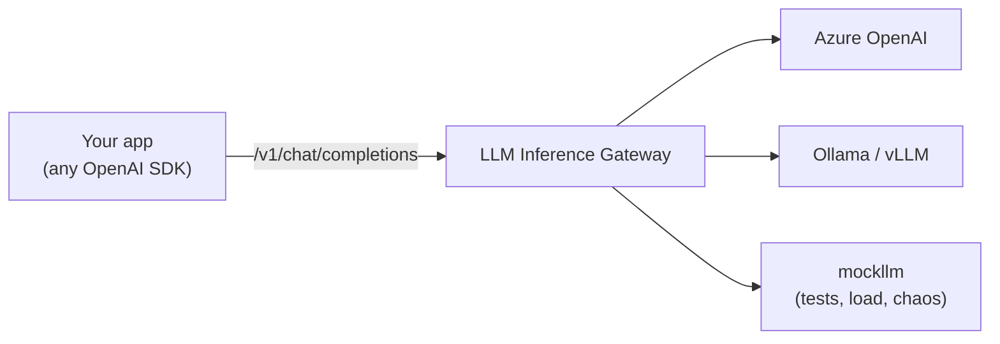

# LLM Inference Gateway

[](https://github.com/eswar-varun/llm-inference-gateway/actions/workflows/ci.yml)

[](https://github.com/astral-sh/ruff)
[](LICENSE)

An OpenAI-compatible gateway that sits between applications and LLM providers (Azure OpenAI,
OpenAI, Ollama, vLLM, …) and gives every team the same routing, failure handling, rate
limiting, caching and observability, without changing a line of client code.



> **Status: milestone 1 of 5.** The core proxy is done. See the [roadmap](#roadmap).

## Why

Every service that calls an LLM ends up re-implementing the same things: retries, timeouts,
provider failover, per-team quotas, cost tracking, tracing. Doing it once, in a gateway,
means one place to get it right and one place to measure it.

## Highlights

| Behavior | Why it matters | Proven by |
|---|---|---|
| Streams commit to `200` only after the upstream's first chunk | upstream failures get real status codes, not a `200` with a broken body | [`test_upstream_failure_before_first_token_gets_a_real_status`](tests/test_streaming.py) |
| Mid-stream failures end with an error event and **no** `[DONE]` | a truncated answer can never look complete | [`test_mid_stream_failure_becomes_an_error_event`](tests/test_upstream_errors.py) |
| Client hang-up closes the upstream request | no paying for tokens nobody reads; upstream aborted in ~230 ms | [`test_client_hang_up_aborts_the_upstream_stream`](tests/test_integration.py) (real sockets) |
| Every failure classified into one `ErrorKind` | status code and retryability decided in one table, not by string matching | [`test_upstream_errors.py`](tests/test_upstream_errors.py) |

## What works today (milestone 1)

- `POST /v1/chat/completions`: OpenAI-compatible, streaming (SSE) and non-streaming.
- Model aliases routed to providers from a validated YAML config; unknown request fields
  (tools, `response_format`, `seed`, …) are forwarded untouched.
- Azure OpenAI (deployment paths, `api-key` header) and any OpenAI-compatible API.
- Streams wait for the upstream's first chunk before replying, so upstream failures get real
  HTTP status codes instead of a `200` followed by a broken stream.
- A client that hangs up mid-stream cancels the upstream request, so nobody pays for tokens
  that will never be read (verified by an integration test).
- One error taxonomy: every failure is classified (timeout, rate limit, upstream 5xx,
  misconfiguration, …) and mapped to an OpenAI-style error body and status.
- Connect, read, pool and total-deadline timeouts, each reported distinctly.
- Request IDs (accepted from callers or generated) and one JSON access-log line per request,
  including time-to-first-token and token usage.
- `mockllm`: a fake OpenAI-compatible upstream with tunable latency, generation speed and
  failure rate, changeable at runtime for load tests and fault injection.

## Quickstart

Requires Python 3.12+.

```bash
python -m venv .venv
source .venv/bin/activate          # Windows: .venv\Scripts\activate
pip install -e ".[dev]"

# terminal 1: a fake upstream (300 ms to first token, 50 tokens/s)
python -m mockllm --ttft-ms 300 --tokens-per-s 50

# terminal 2: the gateway
python -m llmgateway --config config/gateway.example.yaml
```

Call it like OpenAI:

```bash
curl -N http://127.0.0.1:8080/v1/chat/completions \
  -H "content-type: application/json" \
  -d '{"model": "mock-small", "stream": true,
       "messages": [{"role": "user", "content": "hello"}]}'
```

```python
from openai import OpenAI

client = OpenAI(base_url="http://127.0.0.1:8080/v1", api_key="unused")
stream = client.chat.completions.create(
    model="mock-small", stream=True,
    messages=[{"role": "user", "content": "hello"}],
)
for chunk in stream:
    if chunk.choices:
        print(chunk.choices[0].delta.content or "", end="", flush=True)
```

To use a real provider, copy `config/gateway.example.yaml` to `config/gateway.yaml`
(git-ignored), fill in your Azure resource or Ollama URL, and export the key named in
`api_key_env`. Keys are never read from the YAML.

## Error semantics

| Upstream outcome | Client sees | `error.code` |
|---|---|---|
| 400 / 413 / 422 (bad request, e.g. context too long) | same status, upstream message | `invalid_request` |
| 401 / 403 / 404 (our key or deployment is wrong) | 502 | `upstream_config` |
| 429 | 429 + `Retry-After` | `rate_limited` |
| 5xx | 502 | `upstream_server` |
| connect failure / dropped connection | 502 | `connection` |
| read timeout or total deadline exceeded | 504 | `timeout` |
| gateway's own connection pool exhausted | 503 | `overloaded` |
| unparseable response | 502 | `upstream_protocol` |
| failure *after* a stream started | in-band `data: {"error": …}`, no `[DONE]` | as above |

The reasoning behind each row is in [docs/DESIGN.md](docs/DESIGN.md).

## Tests

```bash
pytest          # 46 tests, ~3 s
ruff check .
```

Three layers: `httpx.MockTransport` scripts exact upstream bytes and failures; an in-process
mock server covers request/response shape; uvicorn-backed integration tests cover what only
real sockets show (incremental delivery, client disconnects).

## Roadmap

| Milestone | Scope | Status |
|---|---|---|
| 1. Core proxy | OpenAI-compatible API, streaming, routing, error taxonomy, mock upstream | ✅ |
| 2. Resilience | retries with capped exponential backoff + jitter, retry budgets, circuit breakers, provider failover, load shedding, chaos tests | ⏳ |
| 3. Multi-tenancy | API keys → tenants, distributed token-bucket rate limiting (Redis + Lua), idempotency keys, token/cost accounting | ⏳ |
| 4. Semantic cache | embedding cache with threshold tuned on labeled duplicate-question pairs (precision vs hit-rate) | ⏳ |
| 5. Observability & benchmarks | OpenTelemetry GenAI traces, Prometheus metrics, Docker Compose, load-test results | ⏳ |

## Docs

- [docs/DESIGN.md](docs/DESIGN.md): architecture, request lifecycle, design decisions and the
  alternatives considered.
- [docs/INTERVIEW_PREP.md](docs/INTERVIEW_PREP.md): questions this design invites, and
  exercises for understanding it by breaking it.

## License

MIT
