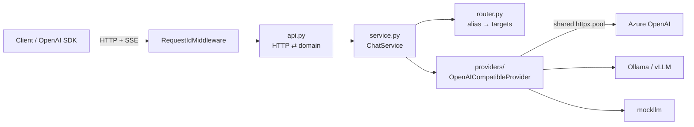
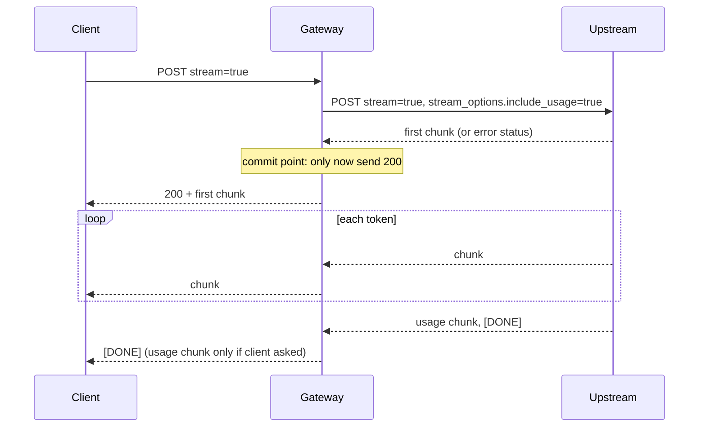

# Design

This document explains how the gateway works and, more importantly, *why* it works that way.
Each decision lists the alternative that was rejected.

## Goals

- **Drop-in:** any OpenAI SDK works by changing `base_url`. No client changes for new features.
- **Honest failures:** a client can always tell *what* failed and *whether retrying helps*.
- **Don't waste money:** never keep paying an upstream for output nobody will read.
- **Measurable:** every claim in the README is backed by a test or a benchmark.

Non-goals for now: prompt rewriting, guardrails, model fine-tuning, a UI.

## Architecture

| Layer | Knows about | Doesn't know about |
|---|---|---|
| `api.py` | HTTP, SSE framing, status codes, access log | providers, routing |
| `service.py` | which target to call, usage accounting, stream relay | HTTP |
| `router.py` | alias → ordered list of `(provider, upstream model)` | transport |
| `providers/` | one upstream's URL scheme, auth, wire format, failure modes | other providers |
| `errors.py` | the failure taxonomy and its HTTP mapping | everything else |

The split matters for what comes next: retries, failover, rate limiting and caching are all
*decisions*, so they go in the service layer, and none of them need to touch HTTP code.

## Request lifecycle

### Non-streaming

1. Validate the body (only `model`, `messages`, `stream`; everything else passes through).
2. Resolve the alias to targets; use the first (failover arrives in milestone 2).
3. Rewrite `model` to the provider's name for it and POST upstream under a total deadline.
4. Classify any failure into an `ErrorKind`; return the upstream body unchanged on success.
5. Emit one access-log line: latency, provider, tokens, error kind.

### Streaming

## Decisions

### D1. Speak the OpenAI API, not a custom one

Every major SDK, framework (LangChain, LlamaIndex) and local server (Ollama, vLLM) already
speaks it. A custom API would make adoption a migration project.
*Rejected:* a provider-neutral custom schema. It's cleaner, but every client has to change.

### D2. Validate little, forward everything

The request models use `extra="allow"` and are dumped with `exclude_unset=True`. The gateway
validates only what it routes on, so new upstream parameters work on day one, and explicit
`null`s the client sent survive while defaults the client never sent aren't invented.
*Rejected:* a full schema. It would reject valid requests whenever OpenAI adds a field.

### D3. Wait for the first chunk before committing to `200`

HTTP status and headers go out before the body. If the gateway sent `200` the moment it
*started* an upstream call, a refused connection or upstream `503` could only be reported
inside an already-successful response, and many clients would treat a truncated stream as
complete. So `ChatService.open_stream` awaits the first upstream chunk first. Anything that
fails before then gets a real status code (and in milestone 2, a retry on another provider,
which is only safe *before* any bytes reach the client).
*Cost:* the client's first byte waits for the upstream's first byte, which it had to do
anyway.

### D4. After the commit point, fail in-band and never send `[DONE]`

Once bytes are on the wire the status can't change. The gateway emits
`data: {"error": {...}}` (which the OpenAI SDKs raise on) and ends the stream *without*
`[DONE]`, so a truncated answer can never be mistaken for a complete one.

### D5. Client disconnect cancels the upstream request

When a user closes a tab mid-answer, the upstream connection must drop so generation stops
instead of running to `max_tokens` on our bill. A hang-up can reach the gateway in two ways,
and both are covered:

1. **Cancellation.** Starlette watches for the ASGI `http.disconnect` message and cancels the
   response task. `CancelledError` is raised at the innermost `await` (the upstream read)
   and unwinds through `aclosing(upstream)` in `service.py::_relay` and `response.aclose()`
   in the provider. This is what happens under uvicorn today.
   Test: `test_client_hang_up_aborts_the_upstream_stream` (real sockets).
2. **Generator close.** Servers that notice a hang-up only when a write fails close the body
   generator at its `yield` instead. Nothing is raised inside the relay then, so
   `api.py::_sse_body` closes it explicitly in `finally`. Without that line the upstream
   stays open until garbage collection happens to finalize the generator.
   Test: `test_closing_the_response_body_closes_the_upstream`.

### D6. Four timeouts, not one

| Timeout | Bounds | Why it's separate |
|---|---|---|
| connect (2 s) | TCP + TLS handshake | a dead host should fail fast |
| read (30 s) | silence between bytes | for streams, this is a stalled-generation detector |
| pool (2 s) | waiting for a free connection in *our* pool | means *we* are saturated → `503 overloaded`, not an upstream timeout |
| total (120 s) | a whole non-streaming call | a read timeout alone never fires on an upstream that trickles one byte every 29 s |

Streams have no total deadline: a long answer is legitimate, and a stall is caught by the
read timeout.

### D7. A closed set of error kinds decides the status code

`errors.py` maps every failure to an `ErrorKind`, and the kind alone determines the HTTP
status, the OpenAI error `type`, and whether a retry could help. Two non-obvious rows:

- **Upstream 401/403/404 → 502, not passed through.** The client authenticated to *us*
  successfully; the upstream rejected *our* key or deployment name. Passing through `401`
  would tell the client to fix credentials it doesn't control.
- **Upstream 400/413/422 → passed through with the upstream's message.** "Maximum context
  length exceeded" is the client's to fix, so they need to see it.

Milestone 2's retry/failover logic switches on `kind` and `retryable`, never on messages.

### D8. Always request usage upstream; only forward it if asked

Cost accounting needs token counts for streams, which OpenAI-style APIs only send when
`stream_options.include_usage` is set. The gateway always sets it, records the usage, and
drops the usage-only chunk (`choices: []`) unless the client asked for it, because clients
that didn't ask may not expect an empty `choices` array. Providers that reject the option can
opt out with `stream_usage: false`.

### D9. One shared connection pool

All providers share one `httpx.AsyncClient`, so TCP and TLS sessions to each upstream host are
reused across requests. A TLS handshake to a cloud endpoint costs tens of milliseconds, which
matters when the target is a fast cached response.

### D10. Raw ASGI middleware for request IDs

Starlette's `BaseHTTPMiddleware` wraps responses in a way that has historically interfered
with streaming and cancellation. The request-ID middleware is ~20 lines of plain ASGI and
touches only the `http.response.start` message.

### D11. Don't trust caller-supplied request IDs blindly

`X-Request-ID` is accepted only if it matches `[A-Za-z0-9._-]{1,128}`; otherwise a fresh one
is minted. The value is written into headers and logs, so unchecked input would allow header
or log injection.

## Testing strategy

| Layer | Tool | Catches |
|---|---|---|
| Upstream failure modes | `httpx.MockTransport` | exact status/bytes/exceptions → correct client-facing error |
| Request/response shape | `mockllm` in-process via `ASGITransport` | payload rewriting, pass-through, SSE framing, usage handling |
| Timing and cancellation | `mockllm` + gateway under uvicorn on ephemeral ports | incremental delivery, disconnect propagation |

`ASGITransport` buffers whole responses, so tests that care about *when* bytes arrive or
what happens on hang-up must use real sockets.

## Known limitations (milestone 1)

- Only the first target of a route is used: no failover or retries yet.
- No client authentication, quotas or rate limiting yet.
- `Retry-After` is parsed only in its seconds form, not as an HTTP date.
- `mockllm` counts whitespace-separated words as tokens.
- Bedrock needs SigV4 signing and the Converse API, so it requires its own provider class.
